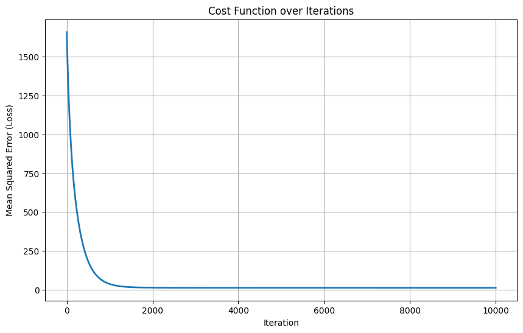
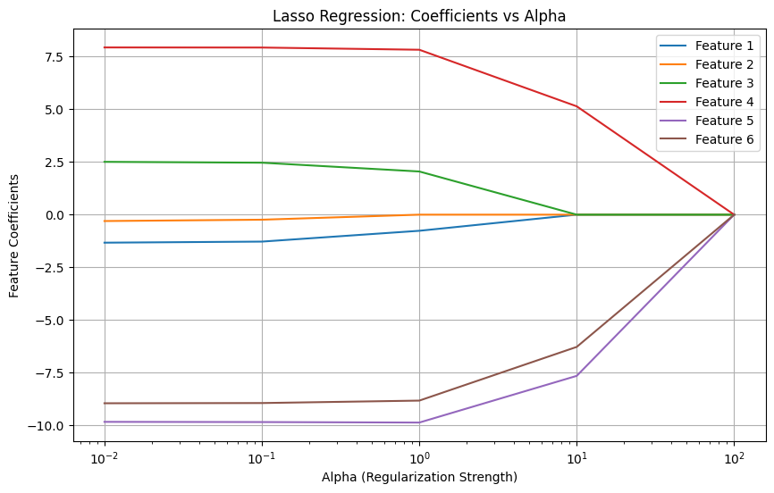
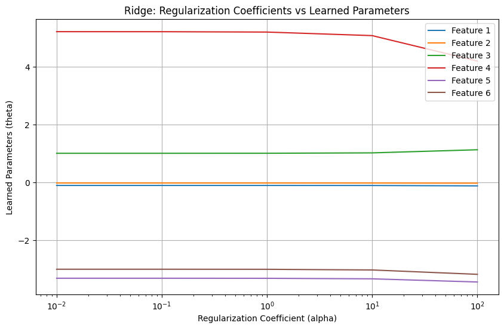
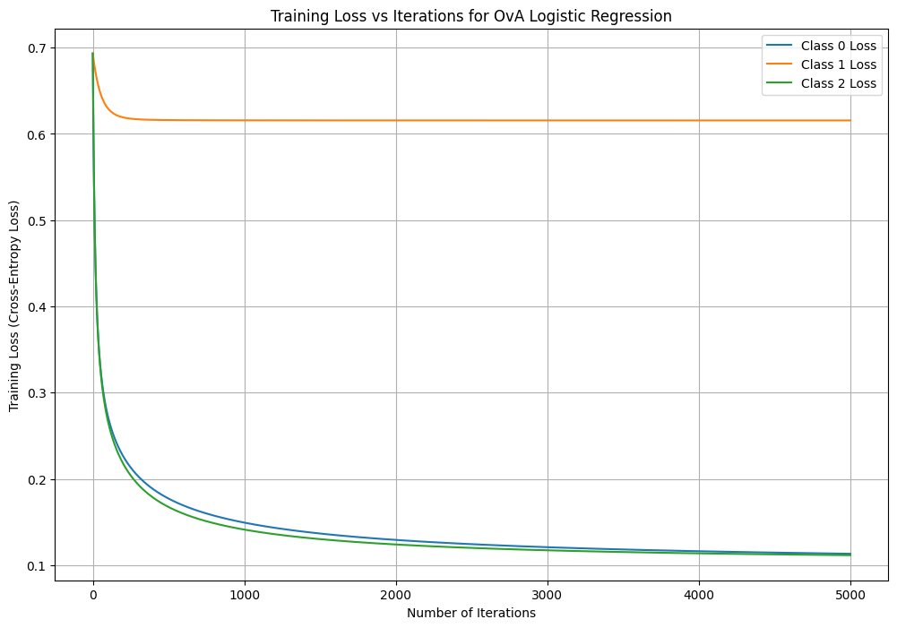
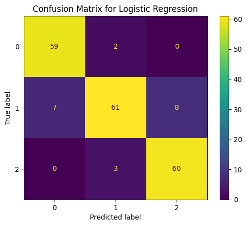

# Linear & Logistic Regression from Scratch (NumPy)


Linear regression and multiclass logistic regression implemented **from scratch in NumPy**: a custom scaler, gradient descent, cross-entropy with L2 regularisation, One-vs-All, and hand-computed metrics. Both models are benchmarked against scikit-learn.

> Built for a Machine Learning course at LUMS (programming assignment 2). The assignment's story: screen passengers boarding a spaceship escaping a zombie apocalypse, using a synthetic "human-zombie score".

| Notebook | Task | From scratch | scikit-learn |
|---|---|---|---|
| [`01_linear_regression.ipynb`](01_linear_regression.ipynb) | Predict a 0–100 score (regression) | Test RMSE **4.9**, R² **0.97** | Same (Linear, Ridge, Lasso, Elastic Net compared) |
| [`02_logistic_regression_ova.ipynb`](02_logistic_regression_ova.ipynb) | Classify into 3 risk classes | Accuracy **88.0%**, macro F1 **0.880** | Accuracy **90.0%**, macro F1 **0.901** |

---

## Dataset

1,000 synthetic individuals ([`data/human_zombie_dataset_v5.csv`](data/human_zombie_dataset_v5.csv)), provided by the course.

| Feature | Correlation with score |
|---|---|
| Height (cm) | −0.64 |
| Weight (kg) | −0.36 |
| Screen Time (hrs/day) | +0.81 |
| Junk Food (days/week) | +0.94 |
| Physical Activity (hrs/week) | −0.95 |
| Task Completion (0–10) | −0.95 |
| **Target:** Human-Zombie Score | 0 = human, 100 = zombie |

---

## 1. Linear regression

**From scratch:** a `StandardScaler` class (fit on the training set only), plus a `LinearRegression` class with batch gradient descent that minimises $J(\theta) = \frac{1}{2m}\sum (h_\theta(x) - y)^2$ (learning rate 0.001, 10,000 iterations).

| Model | Train cost (½·MSE) | Test cost (½·MSE) |
|---|---|---|
| **Gradient descent (from scratch)** | 13.32 | **12.05** |
| scikit-learn `LinearRegression` | 13.31 | 12.07 |

The hand-written model matches scikit-learn's closed-form solution: a test RMSE of **~4.9 points** on a 0–100 scale (R² ≈ 0.97).

<p align="center"></p>

**Regularisation (scikit-learn):** Ridge, Lasso and Elastic Net were tested with α from 0.01 to 100. With 6 features and 800 training rows the plain model doesn't overfit, so regularisation adds bias without reducing variance. Small α leaves the error unchanged, and large α inflates it (at α = 100, Lasso and Elastic Net shrink every weight to 0 and just predict the mean).

<p align="center">
  
  
</p>

The Lasso path doubles as a feature ranking (features 1–6 = height, weight, screen time, junk food, physical activity, task completion). **Weight** is dropped first, then **height** and **screen time**. **Junk food, physical activity and task completion** survive the longest, which matches their correlations with the score.

---

## 2. Logistic regression: One-vs-All

The score is converted into three classes: **0 = human** (0–33), **1 = needs further tests** (33–66), **2 = zombie** (66–100), with roughly 330 people in each.

**From scratch:** a `RegularizedLogisticRegression` class with sigmoid, binary cross-entropy + L2 penalty, gradient descent, prediction at a 0.5 threshold, and accuracy, F1 and the confusion matrix computed by hand. One classifier is trained per class, and the highest probability wins.

<p align="center"></p>

| Binary classifier | Accuracy | F1 |
|---|---|---|
| Class 0 vs rest | 96.5% | 0.944 |
| Class 1 vs rest | 62.0% | **0.000** |
| Class 2 vs rest | 95.0% | 0.922 |

**Multiclass test results (200 people):**

| | Pred: human | Pred: tests | Pred: zombie |
|---|---|---|---|
| **True: human** | 61 | 0 | 0 |
| **True: tests** | 12 | 55 | 9 |
| **True: zombie** | 0 | 3 | 60 |

**Key insights**
- **The middle class can't be separated with one straight line.** The "needs tests" vs rest classifier plateaus at a high loss (the orange curve) and never predicts positive. That class sits *between* the other two, so no single linear boundary can split it from both.
- **OvA still rescues it.** Taking the *highest* probability instead of a 0.5 cutoff classifies 55 of the 76 middle-class cases correctly.
- **No dangerous mistakes.** No human was ever classified as a zombie, and no zombie was let on board as human. Every error involves the "needs tests" class.
- **scikit-learn benchmark:** a grid-searched `LogisticRegression` (C = 10, lbfgs, 5-fold CV) reaches 90.0% accuracy, only 2 points above the from-scratch version.

<p align="center"></p>

---

## Possible improvements
- Since the classes come from an **ordered** score, multinomial (softmax) or ordinal regression, or simply thresholding the linear model's predicted score, would match the problem's structure better than One-vs-All.
- Fit Ridge on standardised features too (it currently uses the raw ones), so that α means the same thing across all three regularised models.

## Repository structure

```
├── 01_linear_regression.ipynb        # Gradient descent from scratch + Ridge/Lasso/Elastic Net
├── 02_logistic_regression_ova.ipynb  # Regularised logistic regression + One-vs-All from scratch
├── data/
│   └── human_zombie_dataset_v5.csv
├── images/                           # Charts used in this README
├── requirements.txt
└── README.md
```

## How to run

```bash
git clone https://github.com/Hasan8036/linear-logistic-regression-from-scratch.git
cd linear-logistic-regression-from-scratch
pip install -r requirements.txt
jupyter notebook
```
Both notebooks run in a few seconds on a laptop.

> `requirements.txt` pins scikit-learn below 1.7, because notebook 2 uses `LogisticRegression(multi_class="ovr")`, which newer versions removed.

## Tech stack

`NumPy` · `pandas` · `Matplotlib` · `Seaborn` · `scikit-learn` (benchmarks only)

## Author

**Hasan Malik**: BS Computer Science, LUMS · MMA candidate, McGill University
GitHub: [@Hasan8036](https://github.com/Hasan8036)
